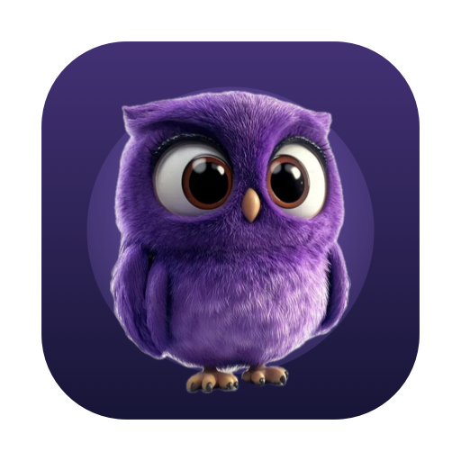
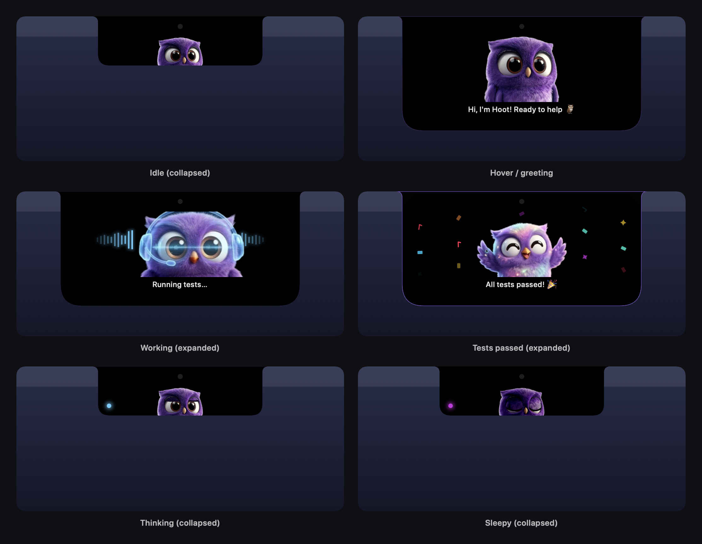
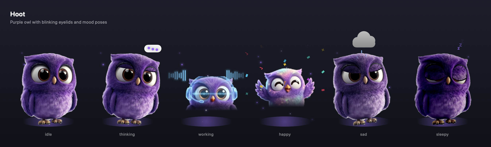

<p align="center">
  
</p>

<h1 align="center">Kiri 🦉</h1>
<p align="center"><b>A desktop pet for macOS that actually codes.</b><br>
It runs your tests, gets sad when they fail, fixes the bug with Claude, and celebrates when they pass.</p>

<p align="center">
  
</p>

## What it does
- **Lives on your Mac:** Hoot the owl floats on your desktop or, on MacBooks with a notch, **lives in the notch** and expands when something happens.
- **Real coding help:** chat about your project, find bugs, and let it **fix failing tests**. Powered by [Claude Code](https://claude.com/claude-code).
- **Feelings:** idle → thinking → working (headphones) → **sad** when tests fail → **celebrating** when they pass → sleepy late at night. It blinks with real furry eyelids.
- **Voice:** press **⌥Space in any app**, talk (works great with Wispr Flow), and Kiri **reads the answer out loud**.
- **Sees your screen:** press 📸 or ask *“what's on my screen?”* and Hoot explains what you're looking at.
- **Mac tasks:** *“Open Safari”*, *“Remind me to stretch at 5pm”*, *“Organize my Downloads”*, *“Turn on focus”*.
- **Watches in the background:** 👀 re-runs tests whenever you save, and an optional terminal hook lets Hoot notice failed commands and offer help.
- **Asks before risky things:** if Claude wants to run a command or edit a file it isn't allowed to, Kiri shows exactly what and lets you **Allow once** (⚠️ marks risky ones).
- **Live progress:** *“Running tests… 3 passed · 1 failed”*.
- **Worried when your battery is low** (unplugged, ≤20%) until you plug in. 🔋
- **Safe by default:** read-only until you flip **Can edit files**, and it can only run your test commands.
- **Light on your Mac:** 8–24 fps, GPU-drawn, and it pauses when hidden.

| Notch mode (MacBook Pro / Air with notch) | Desktop mode (every Mac) |
|---|---|
|  |  |

## Install
1. Download **`Kiri-1.1.2.dmg`** from Releases, open it, and drag **Kiri** into **Applications**.
2. First launch: **right-click Kiri → Open → Open** (it isn't notarized yet).
3. One-time Claude setup in Terminal:
   ```bash
   npm install -g @anthropic-ai/claude-code   # if you don't have `claude` yet
   claude --setting-sources project,local       # then type /login and sign in
   ```
4. Click **Allow** when macOS asks whether Kiri can read your project folder.

Requires **macOS 14+**, Apple Silicon or Intel.

## Use it
- **Press ⌥Space in any app** → chat opens with the text box focused. Talk with **Wispr Flow** or type, then press **Enter** to send (Shift+Enter = new line). ⌥Space again closes it.
- **🔊 button** in the chat: Kiri reads replies and test results out loud (click to mute).
- **Click the owl** to chat, **drag** it anywhere, **right-click** for more.
- **📸** = ask about your screen (needs Screen Recording permission once). **👀** = re-run tests on every save.
- **🦉 menu → Set Up Terminal Watching…** adds a one-line hook to `~/.zshrc` (only when you click Add).
- **Focus on/off** uses two Shortcuts you create once: “Kiri Focus On” / “Kiri Focus Off” (Set Focus → Do Not Disturb).
- **Organize folder** only moves files into type folders (never deletes), asks first, and logs moves to `~/Library/Logs/Kiri-moves.log`.
- **Choose project** → the folder Kiri works in. **▶ Run tests** detects npm, swift, cargo, go, pytest/unittest and make.
- Tests fail → the owl gets sad and offers **Fix it**. Turn on **Can edit files** so it can change code.
- **🦉 menu bar → Display:** Auto / Notch (simulate on any Mac) / Desktop pet.

## Try the demo
```bash
open ../kiri-demo            # a tiny Python project with a deliberate bug
../kiri-demo/reset-demo.sh   # put the bug back after a demo
```
See **[DEMO.md](DEMO.md)** for a shot-by-shot 30-second demo video script.

## Build from source
```bash
./make-app.sh          # universal Kiri.app (Apple Silicon + Intel)
./make-app.sh --fast   # quicker, this Mac only
./make-app.sh --install  # build and move into /Applications (do this for Screen Recording)
./make-dmg.sh          # dist/Kiri-1.1.2.dmg installer
```
Needs Xcode command line tools (Swift 5.9+).

### Project layout
| File | What it is |
|---|---|
| `Sources/Kiri/OwlCharacter.swift` | Hoot: poses, fur eyelids, mood effects |
| `Sources/Kiri/Notch.swift` | Notch island mode and notch detection |
| `Sources/Kiri/PetState.swift` | Moods, speech bubbles, chat and test flow |
| `Sources/Kiri/ClaudeRunner.swift` | Runs `claude -p` headlessly and streams progress |
| `Sources/Kiri/TestRunner.swift` | Detects and runs project tests |
| `Sources/Kiri/HotKeyVoice.swift` | ⌥Space global hotkey and spoken replies |
| `Sources/Kiri/ScreenHelp.swift` | Screenshots for “what's on my screen?” and the Allow dialog |
| `Sources/Kiri/MacActions.swift` | Open apps/links, reminders, focus, organize folders |
| `Sources/Kiri/Watchers.swift` | Test-on-save file watcher and terminal-error hook |
| `Sources/Kiri/Battery.swift` | Low-battery detection |
| `Sources/Kiri/Views.swift` | Chat panel and speech bubble |
| `Sources/Kiri/App.swift` | Windows, menu bar, display mode |
| `characters/` | Character art (drop your own PNGs into `~/Library/Application Support/Kiri/characters/`) |

Other looks (Orbi, Wisp, Termi, Iris, Nimbus, Bubbles, Prism, Sprout) are under right-click → **Character**.

## Troubleshooting
- **Owl thinks forever / "can't reach Claude":** sign in with `claude --setting-sources project,local` → `/login`. Kiri skips a `~/.claude/settings.json` redirect to a local server that isn't running.
- **Folder permission prompt keeps returning:** unsigned rebuilds look like a new app to macOS. Click Allow once per build.
- **Log:** `~/Library/Logs/Kiri.log` records clicks, Claude requests and test runs.
- **Screen help:** Kiri must be in **/Applications** — macOS won't add an app to Screen Recording from Downloads. Then add it with **+** in *Screen & System Audio Recording* and reopen Kiri.
- **Screen help still says it needs permission:** remove Kiri from *Screen & System Audio Recording* with **–**, re-add `Kiri.app` with **+**, and reopen Kiri. If you build Kiri yourself with the local signing certificate, macOS may also require you to trust that certificate for code signing (Keychain Access → *Kiri Local Signing* → Trust → Code Signing: Always Trust).
- **Keep permissions across your own rebuilds:** `make-app.sh` signs with a local identity named *Kiri Local Signing* when you have one in your keychain, so macOS remembers Kiri's permissions.

---
Made with SwiftUI and Claude Code.
